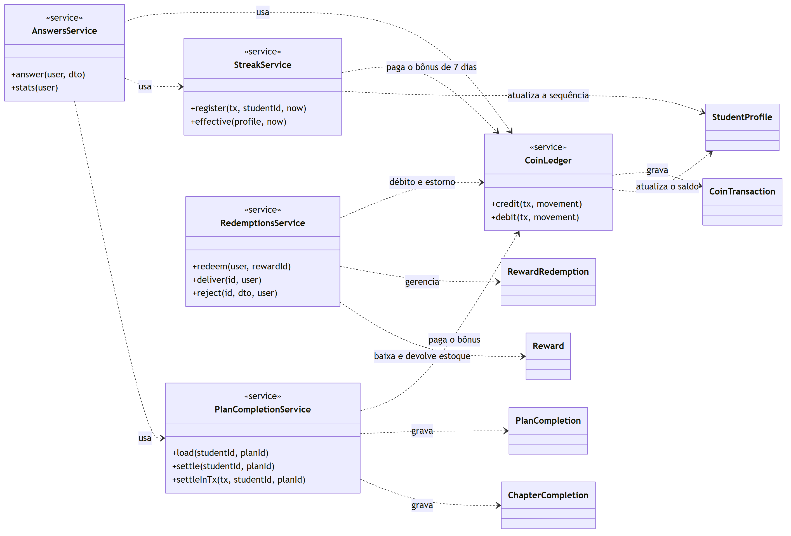
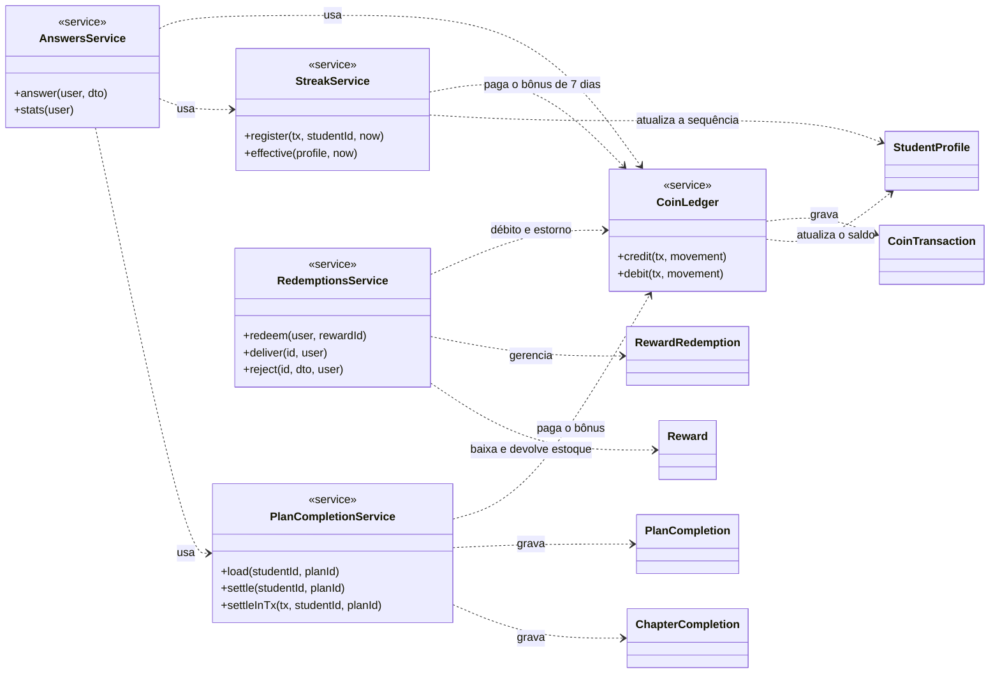

# Diagrama de classes (serviços centrais)

Serviços que concentram as regras de moedas, sequência, conclusão de planos e resgates, e as entidades que eles gravam. `CoinLedger` é o único caminho que altera moedas (RN10); `StreakService` e `PlanCompletionService` pagam bônus por ele; `RedemptionsService` debita e estorna por ele (RN11 e RN12).

