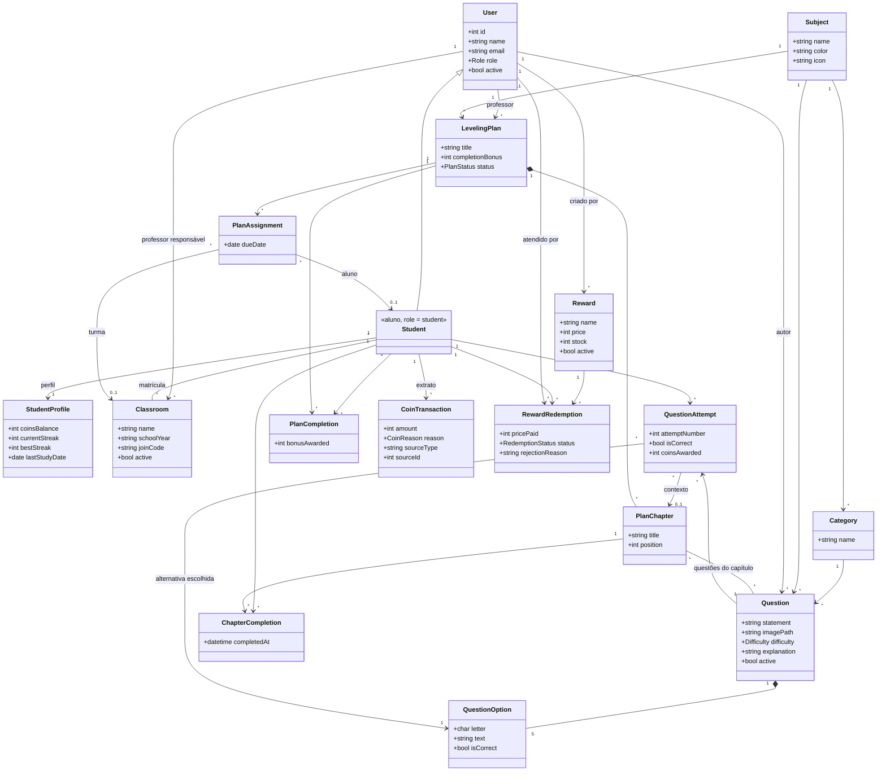

# Diagrama de classes (domínio)

Entidades do domínio, espelhando os models do `schema.prisma`. O Aluno é o `User` com `role = student`; as demais associações do aluno (tentativas, conclusões, extrato e resgates) partem dele. Os serviços centrais estão em [classes-servicos.md](classes-servicos.md).

