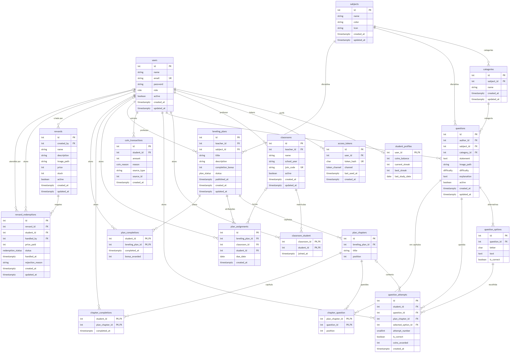
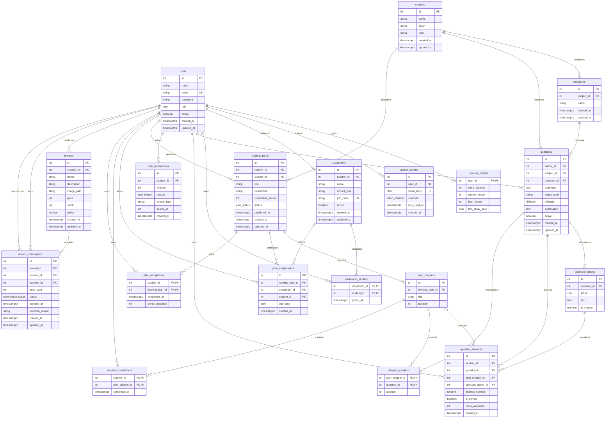

# Diagrama entidade-relacionamento (DER)

Gerado a partir de `apps/api/prisma/schema.prisma`: as 19 tabelas e as 31 chaves estrangeiras. Os tipos mostrados são os do banco de forma simplificada; `timestamptz` é `TIMESTAMPTZ(3)`. Restrições compostas, CHECKs e índices únicos parciais estão descritos em [architecture.md](../architecture.md).

